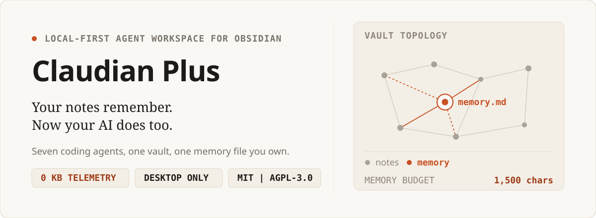
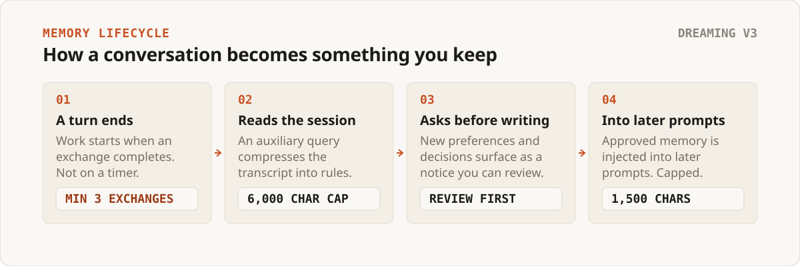
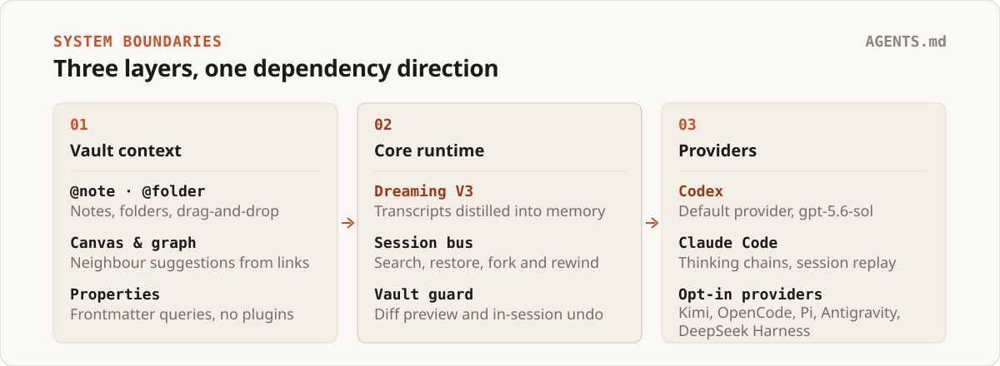

<p align="center">
  <a href="https://github.com/deepseek-ai/deepseek-harness"></a>
</p>

<p align="right">
  <a href="README_ZH.md">简体中文</a> | <b>English</b>
</p>

<p align="center">
  
</p>

<p align="center">
  <a href="https://github.com/wuyifan-code/Claudian-plus/releases"></a>
  <a href="LICENSE"></a>
  <a href="https://obsidian.md/"></a>
  <a href="https://github.com/wuyifan-code/Claudian-plus/actions"></a>
  
</p>

Claudian Plus embeds provider-backed coding agents in your Obsidian sidebar. Codex is the default; Claude, Kimi, OpenCode, Pi, Antigravity and DeepSeek Harness run through the same conversation model. When a session ends, its decisions are distilled into `.claudian-plus/memory.md` — plain Markdown inside your vault that you can read, edit or delete.

**3.2.5** — Generated interfaces now render inside notes, with their space reserved so the note does not jump; streaming appends plain prose instead of re-parsing the tail. [Changelog](CHANGELOG.md) · [All releases](https://github.com/wuyifan-code/Claudian-plus/releases)

---

## 01 / What it does

<div align="center">
  <a href="docs/assets/claudian-plus-demo.mp4">
    
  </a>
  <p><em>30-second overview. Click for the 720p video.</em></p>
</div>

- **Context arrives as references.** `@note`, `@folder` and drag-and-drop resolve against the vault you already have open.
- **Memory sits in a file.** `memory.md` is in your file list, next to your notes.
- **A session survives a provider switch.** Each provider keeps its own history, so one conversation can move between Codex, Claude, Kimi, OpenCode, Antigravity and DeepSeek Harness.

| What you need | A typical AI extension | Claudian Plus |
| :--- | :--- | :--- |
| **Continuity across sessions** | Erased when the window closes | Distilled into `memory.md` and injected into later prompts |
| **Provider choice** | One vendor's model | Codex by default, plus six more over the same session |
| **Data sovereignty** | Sessions indexed on someone else's server | Prompts, sessions and memory stay under `.claudian-plus/` |

---

## 02 / Generated answers

An agent can answer with a fenced ` ```claudian-ui ` program that renders as native Obsidian DOM. No iframe, no `innerHTML`, and replay is byte-for-byte on every provider.

- **54 components** across layout, text, data, inputs, structure, learning and Obsidian-native widgets — plus 24 pure `@functions` and 8 actions (`@Set`, `@Reset`, `@Toggle`, `@ToAssistant`, `@OpenUrl`, `@Copy`, `@OpenNote`, `@InsertToNote`).
- **`Form` submits once.** Every bound field arrives as exactly one assistant turn; `Quiz` and `Checklist` grade and track progress locally, without a model round-trip.
- **State persists.** Slider positions, selections and checkboxes survive a reload and a history replay — 16 KiB per block, 64 KiB per session.
- **A program can live in a note.** A `claudian-ui` or `openui` fence in a Markdown note renders as the same interface, and the block keeps a private state store, so note widgets never reach conversation state. Programs above 200,000 characters stay plain code.
- **Embeds do not move the note.** The space a block will occupy is reserved from a layout prediction before the block builds, and the chat toolbar gains an **Insert into note** action.
- **`@InsertToNote` is off by default.** When enabled, each use still shows a preview and asks for confirmation before writing at the cursor.
- **Nothing disappears silently.** A program the renderer cannot handle degrades to text, and a fence missing the tag gets a content-sniffing fallback.

---

## 03 / Long sessions

- **One rail tick per question.** The navigator is virtualized and keyed by message id, so ticks keep their position while the answer below them streams. Hover scales a peak: 2.6× on the hovered tick, 1.7× and 1.25× on its neighbours.
- **Tool runs fold into one line.** Every contiguous reasoning-and-tool run becomes a single `Execution details` row with tool count, names, failures and thinking time.
- **Transcript padding is yours.** Settings → Appearance has independent left and right sliders, 0–80 px in steps of 4, applied live.
- **Streaming does not re-parse the answer.** Closed blocks render once and keep their DOM; a plain-prose tail grows by appending text instead of being re-parsed, and only a delta that adds a visual line moves the scroll.
- **The stop button is a 28px circle** with a `Stop generation (Esc)` tooltip, in the corner where your eye already is.

---

## 04 / How memory works

<p align="center">
  
</p>

- **Gated on real usage.** Distillation is evaluated when a turn completes, and only once a session has at least **3 exchanges**. An hourly check consolidates older logs, and startup consolidates anything accumulated while Obsidian was closed.
- **Input is capped.** The transcript handed to the auxiliary query is truncated at **6,000 characters**, so cost stays bounded on long sessions.
- **Nothing is written silently.** Extracted preferences and decisions surface as a notice and wait in Settings for you to accept.
- **Output is capped.** Approved memory is injected within a **1,500 character** budget by default, adjustable in Settings → Memory & Consciousness.
- **You can pull the plug.** `Open memory file` shows exactly what was distilled, and the file is plain Markdown.

> **Memory is opt-in.** `memoryEnabled` defaults to on, but the switches that send a transcript to an auxiliary query default to **off** on new installations, because distilled memory contains personal context.

---

## 05 / Providers

Three layers, one direction of dependency: vault context feeds a provider-neutral core, which dispatches to provider adaptors. Feature code depends on core contracts, never on provider internals.

<p align="center">
  
</p>

| Provider | Access | Transport | Detail |
| :--- | :--- | :--- | :--- |
| **Codex CLI** | Enabled by default | `codex app-server` | Default model `gpt-5.6-sol`, native streaming |
| **Claude Code** | Enabled by default | Claude Agent SDK | Thinking-chain folding, permission modes, project history |
| **Antigravity (Gemini)** | Opt in | `agy` CLI | Registry proxy detection, multi-model, thinking budget |
| **DeepSeek Harness** | Opt in | HTTP Remote + WebSocket mux | Needs Node.js on `PATH`; Desktop build unsupported |
| **Kimi** | Opt in | ACP | Model and command discovery, per-tool approval, image attachments |
| **OpenCode** | Opt in | ACP | Runs as a sandboxed sidecar process |
| **Pi** | Opt in | RPC | Node built-ins plus a bundled TypeBox, so it survives missing tool dependencies |

**DeepSeek Harness** is a first-class provider, implemented directly against the official Harness contracts. Sessions bind to the harness's own history, models come from the native catalog and are refreshed from the settings tab, and every tab in one vault shares a single process. It stays off until you send a turn, so rendering its settings never starts a process. Setup and the exact capability boundary are in [`src/providers/dsh/README.md`](src/providers/dsh/README.md).

Capabilities differ per provider and are declared explicitly, because the codebase is written so no feature can silently assume parity.

---

## 06 / Installation

### Method 1: Install from a release (recommended)

1. Download `main.js`, `manifest.json` and `styles.css` from the [latest release](https://github.com/wuyifan-code/Claudian-plus/releases/latest).
2. Create `.obsidian/plugins/claudian-plus/` inside your vault.
3. Copy the three files into that folder.
4. In Obsidian, open **Settings → Community plugins**, refresh the installed list, and toggle **Claudian Plus** on.

> **Requirements:** Obsidian **1.11.4 or later**, desktop only. Claudian Plus talks to local agent CLI processes and needs filesystem access.

### Method 2: Build from source

Requires **Node.js 24** and at least one provider CLI: [Codex](https://github.com/openai/codex), [Claude Code](https://claude.ai/claude-code), [Antigravity](https://github.com/google/antigravity), [DeepSeek Harness](https://github.com/deepseek-ai/deepseek-harness), [Kimi](https://github.com/MoonshotAI/kimi-cli), [OpenCode](https://opencode.ai/) or [Pi](https://github.com/badlogic/pi-mono).

```bash
git clone https://github.com/wuyifan-code/Claudian-plus.git && cd Claudian-plus
npm ci && npm run typecheck && npm run build
```

Set `OBSIDIAN_VAULT` in `.env.local` and `npm run build` copies the output straight into your vault. Full script list is in [09 / Development](#09--development).

---

## 07 / Commands

| Command | Purpose |
| :--- | :--- |
| `Open chat view` | Open the Claudian Plus sidebar workspace |
| `Quick agent input` | Send a targeted instruction using the current editor selection |
| `New tab` | Open a new session tab |
| `New session (in current tab)` | Start a new conversation in the active tab |
| `Close current tab` | Close the active session tab |
| `Inline edit with AI` | Edit selected text in place |
| `Summarize current note` | Produce a structured summary of the active note |
| `Suggest tags for current note` | Suggest tags from the note's content |
| `Create MOC for topic` | Generate a Map of Content note for a topic |
| `Open memory file` | Open the Markdown file distilled by Dreaming V3 |
| `Cleanup expired short-term memories` | Remove expired short-term memory entries |
| `Dream: consolidate memories` | Run a memory consolidation pass now |
| `Scan vault knowledge` | Rebuild the local knowledge index |
| `Undo last canvas write` | Revert the most recent approved Canvas modification |
| `Check provider CLI health` | Inspect provider CLIs for missing binaries, outdated versions or configuration errors |
| `Copy startup diagnostics` | Copy startup diagnostics for filing an issue |

---

## 08 / Privacy and storage

Everything the plugin knows lives inside your vault:

```text
<your-vault>/
├── .claudian-plus/
│   ├── claudian-plus-settings.json    # Shared settings + provider configs
│   ├── memory.md                      # Distilled memory injected into prompts
│   └── sessions/*.meta.json           # Session metadata
├── .claudian/                         # Legacy Claudian data, read-only migration
└── .obsidian/plugins/claudian-plus/   # main.js, manifest.json, styles.css
```

- **No telemetry.** There is zero analytics code under `src/`. Data leaves your machine only through the provider CLIs you configure.
- **Migration and updates are non-destructive.** An existing `.claudian/` directory is detected and copied, with the originals left intact; provider settings are merged, so an upgrade keeps your existing config.

---

## 09 / Development

```bash
npm run dev                  # Build CSS + start esbuild in watch mode
npm run typecheck            # TypeScript type check
npm run lint                 # ESLint checks
npm run test                 # Unit and integration tests
npm run test:watch           # Re-run tests on change
npm run test:coverage        # Coverage report
npm run test:architecture    # Architecture boundary enforcement
npm run check:performance    # Bundle size and startup performance check
```

---

## 10 / Upstream projects

Claudian Plus is built on two upstream open-source projects.

| Project | Author | License | Contribution |
| :--- | :--- | :--- | :--- |
| **[Claudian](https://github.com/YishenTu/claudian)** | [Yishen Tu](https://github.com/YishenTu) | MIT | Obsidian agent workspace, provider abstraction, session architecture |
| **[Codian](https://github.com/BCS1037/codian)** | [BCS1037 / BCS](https://github.com/BCS1037) | AGPL-3.0 | Live Composer, file browser actions, skills management, provider settings |

*Original and Claudian-derived code is **MIT**; Codian-derived code retains **AGPL-3.0** obligations. See [LICENSE](LICENSE) and [NOTICE](NOTICE).*

Community contributors, credited where the fix landed:

| Contributor | Reported in | Contribution |
| :--- | :--- | :--- |
| **[Mofusigil](https://github.com/Mofusigil)** | [PR #5](https://github.com/wuyifan-code/Claudian-plus/pull/5) | Traced the Codex fork failure to `thread/rollback` being rejected on paginated threads, and verified the inclusive `lastTurnId` boundary against `thread_processor.rs`. Shipped in 3.1.0 as `5ac19e8e`. |
| **[miemiecaigou](https://github.com/miemiecaigou)** | [#9](https://github.com/wuyifan-code/Claudian-plus/issues/9), [#10](https://github.com/wuyifan-code/Claudian-plus/issues/10), [#11](https://github.com/wuyifan-code/Claudian-plus/issues/11), [#12](https://github.com/wuyifan-code/Claudian-plus/issues/12), [#13](https://github.com/wuyifan-code/Claudian-plus/issues/13) | Located the caret-colour specificity conflict, the duplicate-tab and split-block causes of the scrambled history layout, the cold-start console window, and the Antigravity usage-window normalisation path. |

---

## 11 / Community

> **在递归中遇见更深的自己** (Discovering a deeper self within recursion)

- **Issues and feature ideas:** [GitHub Issues](https://github.com/wuyifan-code/Claudian-plus/issues)
- **WeChat Official Account:** 「递归识海」
- **Articles and updates:** [Follow 递归识海](https://mp.weixin.qq.com/s/m2AVQl2PdXERGmIrx4jiuA)
