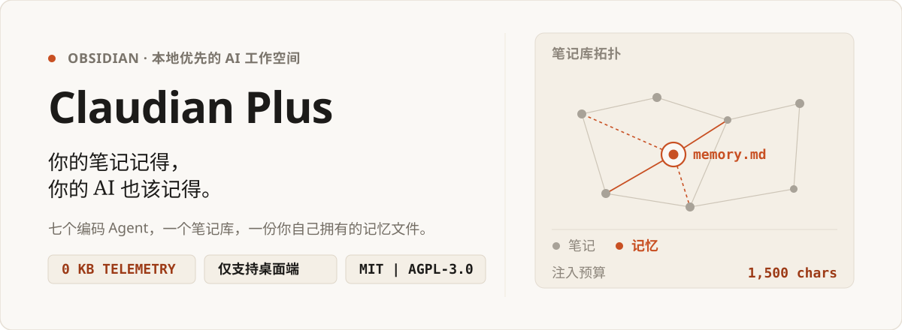
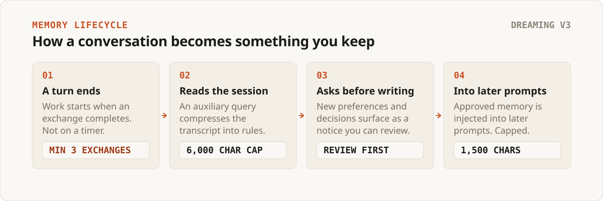
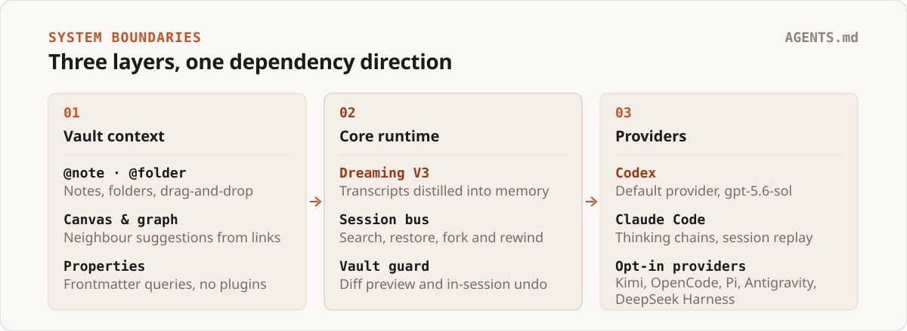

<p align="center">
  <a href="https://github.com/deepseek-ai/deepseek-harness"></a>
</p>

<p align="right">
  <b>简体中文</b> | <a href="README.md">English</a>
</p>

<p align="center">
  
</p>

<p align="center">
  <a href="https://github.com/wuyifan-code/Claudian-plus/releases"></a>
  <a href="LICENSE"></a>
  <a href="https://obsidian.md/"></a>
  <a href="https://github.com/wuyifan-code/Claudian-plus/actions"></a>
  
</p>

Claudian Plus 把编码 Agent 装进 Obsidian 侧边栏。默认使用 Codex，Claude、Kimi、OpenCode、Pi、Antigravity 与 DeepSeek Harness 接入同一套会话模型。一次对话结束后，它的结论被蒸馏进笔记库里的 `.claudian-plus/memory.md`——一份你可以随时打开、修改、删除的纯 Markdown 文件。

**3.2.5** — 生成式界面可以写进笔记，并且先预留空间所以笔记不会跳；流式在纯散文时直接追加文本，不再重解析尾巴。[更新日志](CHANGELOG_ZH.md) · [全部版本](https://github.com/wuyifan-code/Claudian-plus/releases)

---

## 01 / 它能做什么

<div align="center">
  <a href="docs/assets/claudian-plus-demo.mp4">
    
  </a>
  <p><em>30 秒概览。点击查看 720p 视频。</em></p>
</div>

- **上下文以引用进来。** `@note`、`@folder` 与拖拽文件都解析自你已经打开的那个笔记库。
- **记忆落在文件里。** `memory.md` 就在你的文件列表中，和笔记排在一起。
- **切换 Provider 不会打断会话。** 每个 Provider 各自保留历史，同一段会话可以在 Codex、Claude、Kimi、OpenCode、Antigravity 与 DeepSeek Harness 之间流转。

| 你的需求 | 常见的 AI 插件 | Claudian Plus |
| :--- | :--- | :--- |
| **跨会话的连续性** | 关掉窗口就没了 | 蒸馏进 `memory.md`，注入到后续 Prompt |
| **选择 Provider 的自由** | 绑在单一厂商的模型上 | 默认 Codex，另有六个走同一套会话 |
| **数据主权** | 会话被索引到别人的服务器上 | Prompt、会话与记忆都留在 `.claudian-plus/` 下 |

---

## 02 / 生成式回答

Agent 可以用 ` ```claudian-ui ` 围栏程序回答，渲染为 Obsidian 原生 DOM。不用 iframe，不用 `innerHTML`，并且每个 Provider 的历史重放都逐字节保真。

- **54 个组件**，覆盖布局、文本、数据、输入、结构、学习与 Obsidian 原生组件；另有 24 个纯 `@函数` 与 8 个动作（`@Set`、`@Reset`、`@Toggle`、`@ToAssistant`、`@OpenUrl`、`@Copy`、`@OpenNote`、`@InsertToNote`）。
- **`Form` 一次提交。** 内部所有绑定字段打包成恰好一个助手回合；`Quiz` 与 `Checklist` 在本地判分、记进度，不触发模型回合。
- **状态会留下来。** 滑块位置、下拉选择与勾选状态能扛过重载与历史回放——单块 16 KiB、全会话 64 KiB。
- **程序可以住在笔记里。** 笔记中的 `claudian-ui` 或 `openui` 围栏会渲染成同一个界面，并且块持有独立的状态存储，笔记里的控件不会碰到会话状态。超过 200,000 字符的程序按普通代码显示。
- **内嵌块不会让笔记跳动。** 块构建之前先按排版预测预留它要占的空间，聊天工具条则多了一个 **插入到笔记** 动作。
- **`@InsertToNote` 默认关闭。** 即使开启，每次使用仍会显示预览，确认后才插入到光标处。
- **不会静默消失。** 渲染不了的程序降级为文本；模型忘写 `claudian-ui` 标签时，按内容嗅探兜底。

---

## 03 / 长会话

- **一个提问一个刻度。** 导航轨做了虚拟化，用消息 id 作键，上方回答还在增长时刻度不会移位。悬停呈山峰形：命中 2.6 倍，左右邻格 1.7 与 1.25 倍。
- **工具调用折成一行。** 每一段连续的思考与工具调用收成一个 `Execution details` 行，汇总工具数、名称、失败数与思考时长。
- **正文边距由你定。** 设置 → 外观 有左右两个独立滑块，0–80 px，步长 4，拖动即时生效。
- **流式不再重排整条回答。** 已闭合的块只渲染一次并保留 DOM；纯散文的尾巴靠追加文本增长，不再被重新解析，并且只有真正多出一行时才跟随滚动。
- **打断按钮是一个 28px 圆**，提示为 `停止生成 (Esc)`。

---

## 04 / 记忆如何运作

<p align="center">
  
</p>

- **按真实使用触发。** 蒸馏在一轮对话结束时评估，且要求当前会话至少有 **3 轮**交流。另有每小时一次的检查来合并更早的日志，启动时也会合并 Obsidian 关闭期间累积的内容。
- **进入模型前先截断。** 交给辅助查询的记录截断在 **6,000 字符**以内，长会话的蒸馏开销因此有界。
- **不会静默写入。** 新提取出的偏好与决策会以通知形式浮现，在设置里等你去确认。
- **进入 Prompt 前先限流。** 获批的记忆默认在 **1,500 字符**预算内注入，可在 设置 → 记忆与意识 中调整。
- **随时可以拔掉电源。** `打开记忆文件` 如实展示被蒸馏了什么，而那个文件就是纯 Markdown。

> **记忆是选择性开启的。** `memoryEnabled` 默认为开，但真正会把会话内容发给辅助查询的那几个开关，在新装环境下默认**关闭**——因为蒸馏出的记忆包含个人上下文。

---

## 05 / Provider

三层结构，依赖只有一个方向：笔记库上下文喂给 Provider 中立的内核，内核再分派给各 Provider 适配器。功能代码只依赖内核契约，从不依赖 Provider 内部实现。

<p align="center">
  
</p>

| Provider | 启用方式 | 传输 | 细节 |
| :--- | :--- | :--- | :--- |
| **Codex CLI** | 默认启用 | `codex app-server` | 默认模型 `gpt-5.6-sol`，原生流式 |
| **Claude Code** | 默认启用 | Claude Agent SDK | 思维链折叠、权限模式、项目历史回放 |
| **Antigravity (Gemini)** | 手动开启 | `agy` CLI | 注册表代理探测、多模型、Thinking 预算 |
| **DeepSeek Harness** | 手动开启 | HTTP Remote + WebSocket mux | 需要 Node.js 在 `PATH` 上；不支持 Desktop 版 |
| **Kimi** | 手动开启 | ACP | 模型与命令自动发现、按工具审批、图片附件 |
| **OpenCode** | 手动开启 | ACP | 运行在隔离的 sidecar 进程上 |
| **Pi** | 手动开启 | RPC | 只用 Node 内置模块与打包的 TypeBox，外部工具依赖缺失也能跑 |

**DeepSeek Harness** 是一等 Provider，直接对着官方 Harness 契约实现。会话绑定 Harness 自己的历史，模型来自原生目录并且可以在设置页刷新，同一笔记库下的所有标签页共用一个进程。在你发出第一条消息之前它不会启动，所以渲染它的设置页不会拉起进程。安装步骤与完整能力边界见 [`src/providers/dsh/README.md`](src/providers/dsh/README.md)。

各家能力本就不同，且被显式声明——代码层面刻意设计成任何功能都无法悄悄假设对等。

---

## 06 / 安装

### 方式一：从 Release 安装（推荐）

1. 从[最新版本](https://github.com/wuyifan-code/Claudian-plus/releases/latest)下载 `main.js`、`manifest.json` 与 `styles.css`。
2. 在你的笔记库中新建 `.obsidian/plugins/claudian-plus/` 目录。
3. 把这三个文件复制进去。
4. 在 Obsidian 中打开 **设置 → 第三方插件**，刷新列表并启用 **Claudian Plus**。

> **环境要求：** Obsidian **1.11.4 或更高版本**，仅支持桌面端。Claudian Plus 需要与本地 Agent CLI 进程通信并访问文件系统。

### 方式二：从源码构建

需要 **Node.js 24**，以及至少一个 Provider CLI：[Codex](https://github.com/openai/codex)、[Claude Code](https://claude.ai/claude-code)、[Antigravity](https://github.com/google/antigravity)、[DeepSeek Harness](https://github.com/deepseek-ai/deepseek-harness)、[Kimi](https://github.com/MoonshotAI/kimi-cli)、[OpenCode](https://opencode.ai/) 或 [Pi](https://github.com/badlogic/pi-mono)。

```bash
git clone https://github.com/wuyifan-code/Claudian-plus.git && cd Claudian-plus
npm ci && npm run typecheck && npm run build
```

在 `.env.local` 中设置 `OBSIDIAN_VAULT`，`npm run build` 就会把产物直接送进你的笔记库。完整脚本列表见 [09 / 开发](#09--开发)。

---

## 07 / 命令

| 命令 | 作用 |
| :--- | :--- |
| `Open chat view` | 打开 Claudian Plus 侧边栏工作台 |
| `Quick agent input` | 取当前编辑器选区，发送一条针对性指令 |
| `New tab` | 新开一个会话标签页 |
| `New session (in current tab)` | 在当前标签页里开一段新会话 |
| `Close current tab` | 关闭当前会话标签页 |
| `Inline edit with AI` | 就地编辑选中的文本 |
| `Summarize current note` | 为当前笔记生成结构化摘要 |
| `Suggest tags for current note` | 依据笔记内容推荐标签 |
| `Create MOC for topic` | 为某个主题生成内容地图（MOC）笔记 |
| `Open memory file` | 打开由 Dreaming V3 蒸馏出的记忆文件 |
| `Cleanup expired short-term memories` | 清理已过期的短期记忆条目 |
| `Dream: consolidate memories` | 立即执行一次记忆巩固 |
| `Scan vault knowledge` | 重建本地笔记库知识索引 |
| `Undo last canvas write` | 回滚最近一次获批的 Canvas 写入 |
| `Check provider CLI health` | 检查各 Provider CLI 是否缺失、过期或配置有误 |
| `Copy startup diagnostics` | 复制启动诊断信息，便于提 Issue |

---

## 08 / 隐私与数据

插件知道的一切都在你的笔记库内：

```text
<你的笔记库>/
├── .claudian-plus/
│   ├── claudian-plus-settings.json    # 共享设置 + 各 Provider 配置
│   ├── memory.md                      # 蒸馏后用于注入的记忆
│   └── sessions/*.meta.json           # 各会话的元数据
├── .claudian/                         # 旧版数据，只读兼容
└── .obsidian/plugins/claudian-plus/   # main.js、manifest.json、styles.css
```

- **无遥测。** `src/` 下没有任何统计或埋点代码。离开本机的数据只经由你配置的 Provider CLI。
- **迁移与升级都不毁数据。** 检测到旧版 `.claudian/` 目录时按复制方式迁移，原始文件保留；Provider 自有配置采用合并写入，升级会保留你已有的配置。

---

## 09 / 开发

```bash
npm run dev                  # 构建 CSS + esbuild 监听
npm run typecheck            # TypeScript 类型检查
npm run lint                 # ESLint 代码检查
npm run test                 # 单元与集成测试
npm run test:watch           # 变更时重跑测试
npm run test:coverage        # 覆盖率报告
npm run test:architecture    # 跨层级依赖边界守卫
npm run check:performance    # 产物体积上限 + 冷启动评估耗时
```

---

## 10 / Upstream projects

Claudian Plus 站在两个上游开源项目之上。

| 上游项目 | 作者 | 协议 | 贡献 |
| :--- | :--- | :--- | :--- |
| **[Claudian](https://github.com/YishenTu/claudian)** | [Yishen Tu](https://github.com/YishenTu) | MIT | Obsidian Agent 工作台、Provider 抽象、会话系统基础 |
| **[Codian](https://github.com/BCS1037/codian)** | [BCS1037 / BCS](https://github.com/BCS1037) | AGPL-3.0 | Live Composer、文件浏览器动作、Skills 管理、Provider 设置 |

*原创与继承自 Claudian 的代码遵循 **MIT**；继承自 Codian 的代码保留 **AGPL-3.0** 义务。文件级归属见 [LICENSE](LICENSE) 与 [NOTICE](NOTICE)。*

这些排查直接改变了实现，按修复落地处致谢：

| 贡献者 | 提交位置 | 贡献 |
| :--- | :--- | :--- |
| **[Mofusigil](https://github.com/Mofusigil)** | [PR #5](https://github.com/wuyifan-code/Claudian-plus/pull/5) | 定位了 Codex fork 的失败根因——分页线程会拒绝 `thread/rollback`，并对照 `thread_processor.rs` 验证了包含式 `lastTurnId` 边界。已随 3.1.0 的 `5ac19e8e` 落地。 |
| **[miemiecaigou](https://github.com/miemiecaigou)** | [#9](https://github.com/wuyifan-code/Claudian-plus/issues/9)、[#10](https://github.com/wuyifan-code/Claudian-plus/issues/10)、[#11](https://github.com/wuyifan-code/Claudian-plus/issues/11)、[#12](https://github.com/wuyifan-code/Claudian-plus/issues/12)、[#13](https://github.com/wuyifan-code/Claudian-plus/issues/13) | 定位了光标颜色的特异性冲突、历史排版错乱的重复标签页与正文切块两个成因、冷启动控制台窗口，以及 Antigravity 上下文窗口的归一化路径。 |

---

## 11 / 关注与交流

> **在递归中遇见更深的自己**

- **问题与功能建议：** [GitHub Issues](https://github.com/wuyifan-code/Claudian-plus/issues)
- **微信公众号：** 「递归识海」
- **文章与更新：** [关注递归识海](https://mp.weixin.qq.com/s/m2AVQl2PdXERGmIrx4jiuA)
