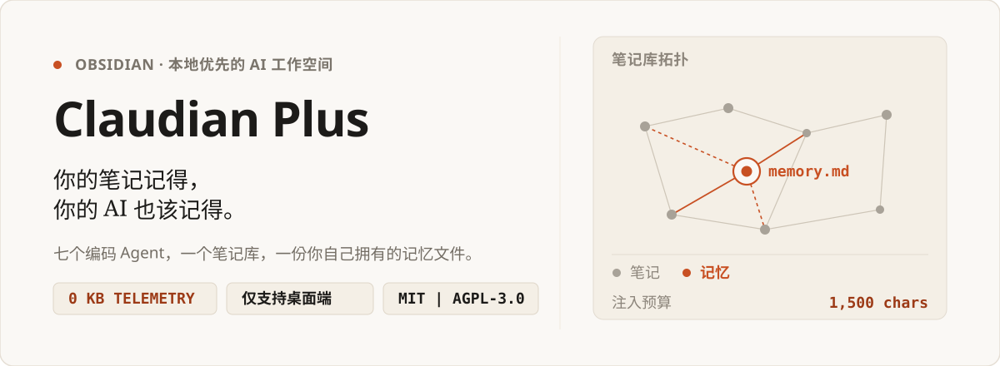
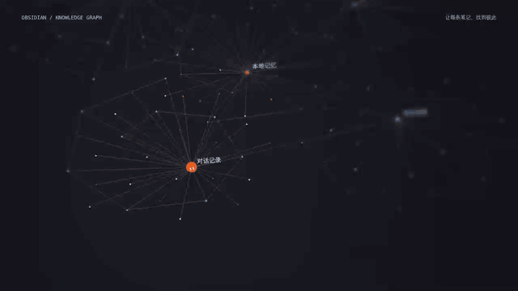
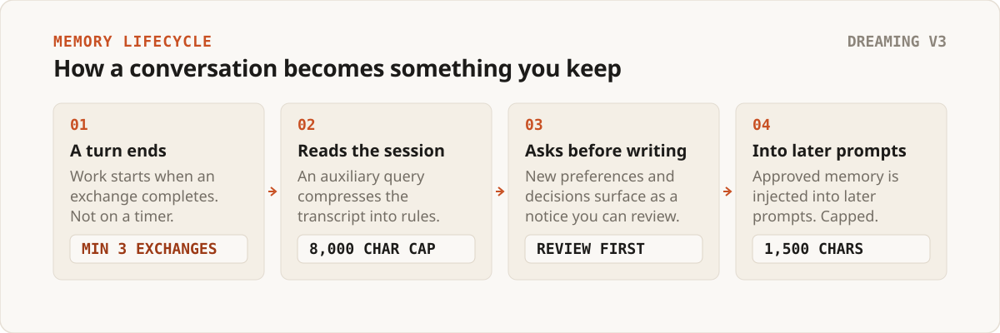
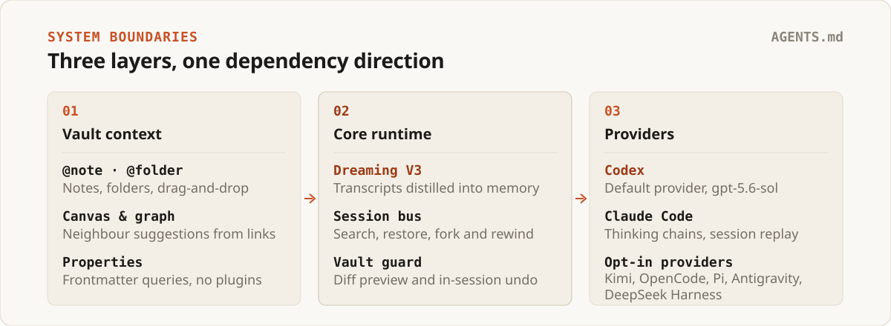

<p align="center">
  <a href="https://github.com/deepseek-ai/deepseek-harness"></a>
</p>

<p align="right">
  <b>简体中文</b> | <a href="README.md">English</a>
</p>

<p align="center">
  
</p>

<p align="center">
  <a href="https://github.com/wuyifan-code/Claudian-plus/releases"></a>
  <a href="LICENSE"></a>
  <a href="https://obsidian.md/"></a>
  <a href="https://github.com/wuyifan-code/Claudian-plus/actions"></a>
  
</p>

<p align="center">
  <strong>你的笔记记得，你的 AI 也该记得。</strong><br>
  七个编码 Agent，一个笔记库，一份属于你自己的记忆文件。
</p>

Claudian Plus 把编码 Agent 深度整合进 Obsidian 侧边栏。默认使用 Codex，Claude、Kimi、OpenCode、Pi、Antigravity 与 DeepSeek Harness 接入同一套会话模型。一次对话结束后，它的结论不会蒸发——而是被蒸馏进笔记库里的 `.claudian-plus/memory.md`，一份你可以随时打开、修改、删除的纯 Markdown 文件。

---

## 🐋 DeepSeek Harness

DeepSeek Harness（`dsh`）现在是一等 Provider。它直接对着官方 Harness 的 HTTP Remote 与 WebSocket mux 契约实现，而不是去适配另一个 Agent 的协议。

- **会话绑定在原生 Harness 历史上。** 重载插件不会丢对话，Harness 进程重启后也能续上——回放读的是 Harness 自己的会话文件，不是副本。
- **流出来的就是 Harness 发出的。** 文本与推理流、工具调用与结果、一次性工具审批、显式 Stop。
- **模型来自 Harness，不是写死的列表。** 在设置里刷新原生目录，选择器列出的是 Harness 真正通告的 provider/model 组合，以及它声明的推理强度。原生默认项继续跟随原生默认，而不是锁定某个模型。本地生成标题不消耗模型额度。
- **一个工作空间只有一个 Harness 进程。** 多个标签页共享同一个 Web-profile 进程，各自 claim 独立的原生会话。
- **默认关闭，不主动启动。** 渲染 Provider 设置不会拉起 Harness。首次启动可能需要几十秒。

**环境要求：** 官方 npm CLI [`@deepseek-ai/dsh`](https://github.com/deepseek-ai/deepseek-harness)（`npm install -g @deepseek-ai/dsh`），且 Node.js 在 `PATH` 上。不支持 Desktop 版可执行文件。在设置里，CLI 路径留空即可自动发现 `dsh` shim，也可以直接指向 `dsh.cmd`/`dsh.ps1` 或其 JavaScript 入口。若 profile 不在默认位置，在 Provider 环境变量里设置 `DSH_HOME`。

**它刻意不做的事：** 图片、fork、rewind、steering、Provider 斜杠命令、共享 MCP/Skill 管理、后台自主子 Agent 均未开放。未知的上下文容量如实报告为未知，不会编成一个 token 数字。完整能力边界见 [`src/providers/dsh/README.md`](src/providers/dsh/README.md)。

---

## 🌟 V3.2.4 更新

**一次关于「导航」与「阅读」的更新。对话导航轨重做，正文边距可以自己留白，流式输出不再每帧重排整条回答。**

### 1. 对话导航轨重做

旧的大纲是从 DOM 里扫出来的，声明了五种类型，实际只产出两种。新的导航轨按读者的理解建模：**一个提问一个刻度**。

- **每个提问一个刻度，身份稳定。** 用消息 id 作键，上方回答还在流式增长时，刻度的位置、预览和焦点都不会丢。
- **悬停是「山峰」，不是高亮。** 命中的刻度放大到 2.6 倍，左右邻居 1.7 / 1.25 倍，其余保持 1 倍；透明度依次 1 / 0.86 / 0.72 / 0.58。只有峰顶使用正文色。
- **轨道虚拟化。** 只挂载落在轨道视口内的刻度，一千个提问和十个提问占用同样的 DOM。
- **当前刻度由视口推导。** 对已测量的行位置做二分，而不是逐像素扫描。
- **预览卡片同时给出提问和回答**，并区分「仍在输出」与「没有文本回复」两种状态。
- **跳转遵循 `prefers-reduced-motion`。**
- 移植自 ZCode 的 `ConversationTurnNavigator`（Apache-2.0），用原生 DOM 重写；署名记录在 `NOTICE`。

随之下线：旧提取器、其中从未被产出的三种类型、类型筛选 chips，以及约 1500 行针对已不存在行为的测试。

### 2. 正文边距可以自己调

设置 → 外观 新增**左**、**右**两个滑块，0–80 px，步长 4，拖动即时生效。

之所以拆成两个：两侧本来不对称——导航轨会占用它所在那一侧的槽位，导致一侧明显更紧。槽位是**叠加**在你设定的值之上，而不是替换它，所以把轨道切到另一侧、或者隐藏轨道，文字只会移动槽位本身的宽度。

### 3. 流式输出不再重排整条回答

以前每一帧都会清空消息、把累积的整段 markdown 交回 `MarkdownRenderer` 重新渲染，再把所有代码块重新包裹、按钮和监听器全部重建。按帧计算，一条长回答的总成本是长度平方级的。

- **已闭合的块只渲染一次并保留 DOM。** 现在每 100ms 只重画末尾未闭合的那一块，单帧成本从「整条消息」降到「一块」。
- **导航轨不再在每次流式刷新时测量所有消息。** 只有最后一条可能在变高，所以只重测那一行。

### 4. 修复

- 轨道刻度改用 `div role="button"`，Obsidian 主题的按钮底色不会再把每个刻度裹成胶囊；Enter / Space 仍然可用。
- 轨道在流式期间较慢的刷新间隔现在真正生效了，之前一直静默回退到快档。

---

## 🌟 V3.2.2 更新

**一次针对生成式 UI 层、冷启动与插件健康度的加固发布。** 下面没有任何新功能面，每一条都是把已构建的产物量出来之后发现的。

### 1. 生成式 UI 组件收成一套设计家族
- **没有时间戳的时间线条目不再塌陷。** 网格轨道改为由行属性驱动，而不是由「这一行恰好输出了几个单元格」决定；连接线由一个随行撑高的轨道列绘制。同一份内容此前被压进 10px 宽的列、逐字竖排、整块高 1064px，现在满宽渲染、高 161px。
- **Obsidian 的元素样式不再渗进组件。** 宿主对 `button`、`input`、`select`、`textarea` 的规则权重会静默压过组件类：按钮被重新居中并重新上色、输入框沿用宿主皮肤、多行卡片被钉死成输入框高度导致文字溢出边框。现在每条按钮与表单控件规则都做了元素限定，并且对「没有组件归属的属性」做了复位。
- **圆角、间距、字号、控件高度各一套标尺。** 标题从五档收敛为三个可见档——`md` 与 `lg` 过去渲染成 20px 和 19.8px、`2xl` 与 `3xl` 完全一致；面板嵌套面板时内层降级为浅底，不再画第二道边框。
- **统一的 markdown 阅读样式。** `MarkdownRenderer.render()` 不会加 Obsidian 的 `.markdown-rendered` 包裹层，所以组件里的代码块、表格、引用、分隔线此前没有任何阅读态排版。现在回答正文与组件共用同一层阅读样式，并按类名排除组件根部，表格组件不会吃到 markdown 表格规则。
- **补齐 361–479px 这一档。** 三列/四列网格降为两列、表头允许折行、徽标允许换行——这个最典型的侧栏宽度此前一条规则都没有。

### 2. 冷启动更快
- 生产包从 **3.68 MiB 降到 3.42 MiB**，冷启动模块求值中位数从 **286.8 ms 降到约 260–272 ms**。两处构建设置起作用：CJK 语言包改用 UTF-8 输出而不是 `\uXXXX` 转义；构建目标提到 ES2022——支持的最低 Obsidian 版本早已搭载更新的 Chromium。

### 3. 插件健康度加固
- **不再使用渲染进程存储。** 引导状态与每安装实例的设备键都改存进插件数据文件。旧版本留在渲染进程存储里的设备键，只在无歧义时才采纳；跨机器同步过的设置不去猜。
- **生产依赖漏洞归零。** `@modelcontextprotocol/sdk` 1.32.2、`smol-toml` 1.9.1、`zod` 4.6.7，以及被钉死的 `hono` override 全部离开受影响区间——`npm audit --omit=dev` 已无告警。
- Promise 拒绝原因统一为 `Error`，并清掉了一处重复的 CSS 声明。


## 🌟 V3.2.1 更新

**社区审阅合规版本。** 3.2.0 的商店条目未通过一项自动检查，本版本修复它。

- **生成式界面渲染器不再直接写内联样式。** 静态样式一律走 CSS 类（`is-bordered`、`is-align-*`、`is-italic` 等），动态值（gap、padding、颜色）走 Obsidian 的 `setCssProps`——`src/features/chat/rendering/ui/components.ts` 的 `obsidianmd/no-static-styles-assignment` 全部清零。
- **该规则在本地 CI 同步提升为 error 级**，今后发布不会再漏放同类问题。

---

## 🌟 V3.2.0 更新

**一个功能版本**，主打 Intelligent UI：Agent 现在可以用可交互的原生界面回答，而不只是 Markdown。

### 1. Intelligent UI（生成式回答）
- **Agent 的回答可以是真正的界面。** Provider 可以用 ` ```claudian-ui ` 围栏程序回复，渲染为 Obsidian 原生 DOM——绝不用 iframe、绝不用 `innerHTML`——并且在所有 Provider 的历史重放里逐字节保真。
- **一门精简的声明式语言。** 54 个组件：布局（`Col`、`Row`、`Grid`、`Card` 等）、文本（`Markdown`、`Icon`、`Math`、`Progress`）、数据（可排序 `Table`、多系列 `Chart`、`Sparkline`、带连线与路径高亮的 `Diagram`）、输入（`Input`、`Slider`、`Select`、`Switch`、`TextArea`、`NumberStepper`、`DatePicker`、`ChoiceCards`、`Form` 等）、结构（`Tabs`、`Accordion`、`Steps`、`Timeline`、`Callout`、`Stat`）、学习（`Flashcard`、本地判分的 `Quiz`、`Checklist`）与 Obsidian 原生组件（`NoteLink`、`NoteCard`、`Mermaid`、`Tag`、vault 相对路径 `Image`）。24 个纯 `@函数`（`@Sum`、`@Round`、`@Each` 等）与 7 个动作（`@Set`、`@Reset`、`@Toggle`、`@ToAssistant`、`@OpenUrl`、`@Copy`、`@OpenNote`），外加 `Action([...])` 多步动作。`@ToAssistant` 可把控件上下文作为下一轮对话发回给 Agent。
- **表单一次提交。** `Form` 把内部所有绑定字段打包成恰好一个助手回合；`Quiz` 与 `Checklist` 在本地判分/记进度，不触发模型回合。
- **界面自己会打磨。** 定稿的界面块淡入一次；流式早期帧显示骨架而不是空白；悬停工具条可复制程序、重置控件状态或放大查看。生成的界面也会以 `UI` 标记进入对话大纲。
- **控件状态跨重载与回放保留。** 滑块位置、下拉选择、勾选状态按会话持久化（单块 16 KiB、全会话 64 KiB），并以消息内容作为键，历史回放与重载都能找回同一份状态。
- **写入笔记默认关闭。** `@InsertToNote` 需在设置 → 外观中显式开启；即使开启，每次使用仍会显示预览并请求确认，确认后才插入到光标处。
- **输入焦点不丢。** 由你自己的按键触发的界面重建——包括流式过程中的重渲染——都会精确恢复焦点与光标位置。
- **每回合只占一行。** 所有思考与工具调用折叠为一行 `Execution details`，汇总显示工具数、名称、失败数与思考时长；点击展开完整细节，无需打开阅读模式。
- **自带兜底。** 语言规范注入每个 Provider 的系统提示词（设置 → 外观 可开关）；无法渲染的程序降级为文本而不是消失；模型忘写 `claudian-ui` 标签时，渲染端按内容嗅探兜底。

### 2. 记忆与意识 V2
- 记忆子系统重写为单管线 V2（dream 任务、仓库维护、claim key、导出视图），零新增依赖；注入预算改为按 token 计算。

### 3. DeepSeek Harness 加固
- **目录刷新失败可见且不破坏数据。** 原生目录返回空或部分 Provider 失败时，现在会报告诊断信息，而不是静默清空你已保存的模型列表。
- `scripts/sync-dsh-profiles.mjs` 可在 DSH 的多个 profile（Desktop ⇄ web）之间同步模型 Provider 配置，绝不触碰凭证。

### 4. 开发体验
- `npm run build` 现在会把构建产物直接部署到同级 vault 检出的 `.obsidian/plugins/claudian-plus/`（其他布局下自动跳过），构建即测试。
- Bundle 预算为新增面提升到 3.85 MB；本版本构建实际 3.62 MiB。

---

## 🌟 V3.1.1 更新

**一次加固版本。** 下面每一条都是审计 3.1.0 代码时发现的缺陷，不是新功能。

### 1. 缺陷修复
- **提示词可能落到错误的会话里。** 在最达标签页上限时，从文件菜单、命令或快捷输入框发送到聊天，会把文字写进当前活跃的那段对话。现在会中止并说明已达上限。
- **多个 Provider 的上下文用量百分比不正确。**
  - Antigravity 的 Gemini 模型实际是 1M 窗口，却按 200K 计算，长会话会让指示器一直顶在 100%。现在按模型族解析窗口（Gemini 为 1M；Antigravity 里托管的 Claude 与 GPT-OSS 模型维持保守值），无法识别的模型 id 保持安全默认值。
  - 上下文容量选择器对 Antigravity 是空操作：写入时用的是一种模型 id 拼写，读取时用的是另一种，下一轮百分比就会弹回原值。现在两种拼写会解析到同一个设置。
  - 选过的容量无法撤销。指示器菜单新增 **使用提供方默认值**，可清除覆盖。
- **每一轮 Claude 对话都弹「Obsidian tools unavailable」。** 构建里没有 MCP SDK 时，失败会被逐轮重试并逐条提示。现在只提示一次，且只有在你显式重载 MCP 服务时才会重新尝试。
- **执行 `!` 命令时闪出控制台窗口。** Windows 上的本地 `!` 命令现在也以隐藏方式启动，与其他所有子进程一致。
- **Claude CLI 探测可能整体失效。** 探测 npm 全局前缀时若遇到权限错误，异常会逃逸并中断整个 CLI 解析流程；现在会降级为「这里没有」并继续查找。
- **多步对话被渲染成多个折叠块。** 连续的思考与工具调用现在合并为一个执行阶段，折叠时只显示一行摘要。
- **注入的记忆上下文被显示成你自己说的话。** 对 ACP 系 Provider（Kimi、OpenCode、Pi）、DeepSeek、Antigravity 与 Codex，注入到用户轮次里的参考材料在从历史回放时不再显示。
- **顶部图标借用了 Claude 的颜色。** 除 Claude 外的所有 Provider 图标现在使用主题黑白，Claude 保留自己的品牌色。

### 2. 说明
- **#11（终端黑框）仍未关闭。** 3.1.0 的修复移除了插件自身的代理探测泄漏。构建产物里看到的 `where.exe` 调用不是插件代码，而是从上游 Claude Agent SDK 内联进来的；剩余「每进程一次」的闪现还需要 reporter 再提供一个信息才能定性。
- **标签栏。** 标签栏按设计保持隐藏；达到上限时新建按钮仍然可见但禁用，上限原因通过提示说明。

---

## 🌟 V3.1.0 更新

**DeepSeek Harness 回归，基于当前架构重写。** 同时修复了 issue 中反馈的三个缺陷。

### 1. DeepSeek Harness Provider
- **分层传输，而非协议适配。** `DshHost` 持有 `dsh serve` 进程，`DshSubprocess` 管理其 stdio，`DshNativeConnection` 直接实现 Harness 的 WebSocket mux 与 HTTP remote 契约，`DshRemoteClient` 在其上提供类型化接口。中间没有经过另一个 Agent 协议的转译。
- **会话绑定 Harness 自己的历史。** 重载插件、切换标签页或重启进程后，都能带着完整轮次记录续接同一段对话。
- **模型来自 Harness 本身。** 模型列表读取原生目录，可在设置页按需刷新，不是写死的快照；推理强度按模型单独暴露。
- **每个工作空间一个进程。** 同一笔记库下的所有标签页共用一个 host，开第二段对话不必再等一次冷启动。
- **默认关闭。** 仅选中该 Provider 不会拉起任何进程，host 在第一次发送消息时才启动。
- **能力边界写在明面上。** 图片、fork、rewind、steering、斜杠命令、共享 MCP/Skill 与后台子代理均未开放；未知的上下文容量如实报告为未知，不换算成 token 数字。

### 2. 缺陷修复
- **深色主题下光标不反色（#9）。** 输入框与实时预览编辑器改用 `--text-normal` 作为 `caret-color`，光标随主题正常反色。
- **历史记录排版错乱（#10）。** 从会话列表打开对话时，不再为同一 id 重复创建标签页；Antigravity 连续的多条 assistant 消息合并为同一个内容块，不再一条一块。
- **每轮对话闪现终端黑框（#11）。** 探测系统代理的注册表查询加上了 `windowsHide`，移除了插件自身的逐轮控制台泄漏。剩余「每进程一次」的闪现仍在 #11 跟踪，本次发布未修复。
- **长会话下 Codex fork 失败。** fork 改为把包含式 `lastTurnId` 检查点传给 `thread/fork`，不再走「fork 全量再回滚」——分页线程会拒绝回滚。

---

## 🌟 V3.0.2 重大更新与核心体验优化

在 **V3.0.2** 中，我们针对长任务交互痛点、网络通信稳定性与视觉体验带来了跨越式升级：

### 1. 连续工具调用智能聚合与自动折叠（Tool Grouping & Auto-Collapse）
- **告别刷屏噪音**：当 Agent 在一次回答中连续调用多个工具（如 10+ 步阅读文件、执行命令、编辑代码）时，不再自上而下铺满整个聊天流。
- **流式展开，完结自折**：工具执行期间动态展开，实时查看当前运行步骤；一旦本轮工具执行完成，整组自动收起为高度仅 ~28px 的单行紧凑卡片。
- **全局状态与一览无余**：卡片上实时显示执行总次数（如 `13 calls`）、调用工具名称摘要，以及全组状态指示灯（任一失败亮红报错，全部成功亮绿）；点击即可随时展开复查详情与代码 Diff。
- **单个工具零干扰**：若仅调用单步工具，保持轻量单行呈现，绝不增加多余的点击折叠负担。

### 2. Antigravity (Gemini) 网络连接稳定性根治与系统代理穿透
- **彻底解决 TUN 虚拟网卡闲置超时断流**：针对 Windows 环境下 Go 编写的 `agy.exe` 不主动读取注册表代理导致走直连、被 Clash/Mihomo TUN Fake-IP 截获并在 4 分钟长思考后被误杀断流（`WSAECONNRESET 10054`）的深层底层机制问题，插件加入了**Windows 注册表系统代理自动嗅探引擎**。
- **零配置，即开即用**：自动探测本机活动系统代理并为子进程静默挂载 `HTTP_PROXY`，彻底打通回环稳定长连接，免去用户手动配置环境变量的烦恼。
- **品牌视觉归位**：集成原生 Antigravity 官方高保真 SVG 图标，告别错用图标；支持 Gemini 3.1 Pro、3.7 Flash、3.8 等最新模型及 Thinking 预算控制。

### 3. 全新旗舰级极简圆形打断按钮（Modern Minimalist Stop Button）
- **对标顶级现代 AI 交互**：彻底移除了突兀的红色边框矩形、"Stop" 文本与键盘徽章，采用极简正圆矢量设计（`28px × 28px`），内嵌圆角停止方块。
- **高反差双主题自适应**：深色模式下为纯白圆底内嵌纯黑圆角方块，浅色模式下为纯黑圆底内嵌纯白圆角方块；配备细腻的触控放大（`scale(1.06)`）与实体按压（`scale(0.94)`）物理动效，悬停原生展示 `停止生成 (Esc)` 提示。

### 4. 界面与排版全面精致化
- **图标上浮修复**：修复了顶部 Provider 图标因定位漂移导致被窗口顶部截断的问题，无论窗口如何缩放始终居中优雅呈现。
- **关于面板焕新**：新增关于卡片与作者公众号互动专区。

---

## 01 / 看看它怎么跑

一段 30 秒的动画概览，说清各部分如何拼在一起：

<div align="center">
  <a href="docs/assets/claudian-plus-demo.mp4">
    
  </a>
  <p><em>点击查看完整画质的 30 秒 720p 版本。</em></p>
</div>

### 三个值得留意的地方

- **上下文以引用形式进来，不是粘贴进来的文本。** `@note`、`@folder` 与拖拽文件都解析自你已经打开的那个笔记库。
- **记忆落在你可以打开的文件里。** 没有数据库，没有同步服务——`memory.md` 就躺在你的文件列表中，和笔记排在一起。
- **切换 Provider 不会打断会话。** 每个 Provider 各自保留自己的历史，同一段会话可以在 Codex、Claude、Kimi、OpenCode、Antigravity 与 DeepSeek Harness 之间无缝流转。

---

## 02 / 核心差异

多数 AI 插件把聊天记录当成一次性文本。Claudian Plus 把一次会话当作工作记录：上下文进来，结论沉淀为记忆，几周之后依然可查。

| 你的需求 | 常见的 AI 插件 | Claudian Plus |
| :--- | :--- | :--- |
| **跨会话的连续性** | 关掉窗口就没了 | 蒸馏进 `memory.md`，注入到后续 Prompt |
| **选择 Provider 的自由** | 被绑死在单一厂商的网页假设上 | 默认 Codex，另有 Claude、Kimi、OpenCode、Pi、Antigravity、DeepSeek Harness |
| **笔记库上下文** | 手动复制粘贴进输入框 | `@note`、`@folder`、拖拽、Canvas、Frontmatter 查询 |
| **数据主权** | 会话被索引到别人的服务器上 | 所有 Prompt、会话与记忆都留在 `.claudian-plus/` 下 |
| **长对话专注度** | 满屏的工具调用与思考噪音 | 智能聚合自动折叠 + 悬浮大纲，把噪音收纳于无形 |

---

## 03 / 它不是什么

- **不是云服务。** 本插件不含任何遥测或统计代码。网络请求由你自己配置的 Provider CLI 从本机发出。
- **不是给笔记软件外挂的聊天窗。** 你的记忆是笔记库里的一个 Markdown 文件，不是别人数据库里的一行记录。
- **不承诺所有 Provider 表现一致。** 各家能力本就不同，且被显式声明——代码层面刻意设计成任何功能都无法悄悄假设对等。

---

## 04 / 记忆到底是怎么运作的

会话会结束，记忆继续。这条链路刻意做得很朴素——四步，没有计时器，也不会背着你写任何东西。

<p align="center">
  
</p>

- **触发条件是真实使用，不是秒表。** 蒸馏在一轮对话结束时评估，且要求当前会话至少有 **3 轮**交流。另有每小时一次的到期检查来合并更早的日志，启动时也会合并 Obsidian 关闭期间累积的内容。
- **进入模型之前先截断。** 交给辅助查询的记录被截断在 **8,000 字符**以内，所以长会话的蒸馏开销是有界的。
- **不会静默写入。** 新提取出的偏好与决策会以通知形式浮现，在设置里等你去确认。
- **进入 Prompt 之前先限流。** 获批的记忆默认在 **1,500 字符**预算内注入，其中画像层 350 字符、项目层 500 字符。三个数值都可以在 **设置 → 记忆与意识** 中调整。
- **你随时可以拔掉电源。** `打开记忆文件` 会如实展示被蒸馏了什么，而那个文件就是纯 Markdown。

> **记忆是选择性开启的。** `memoryEnabled` 默认为开，但真正会把会话内容发给辅助查询的意识与自动记忆开关，在新装环境下默认**关闭**——因为蒸馏出的记忆包含个人上下文。想用时，在 **设置 → 记忆与意识** 里打开。

---

## 05 / Provider 与依赖方向

三层结构，依赖只有一个方向：笔记库上下文喂给 Provider 中立的内核，内核再分派给各 Provider 适配器。功能代码只依赖内核契约，从不依赖 Provider 内部实现。

<p align="center">
  
</p>

- **Codex CLI —— 默认启用。** 默认模型 `gpt-5.6-sol`，通过 `codex app-server` 原生流式输出。
- **Claude Code —— 默认启用。** 支持思维链折叠、权限模式与原生项目历史回放。
- **Antigravity (Gemini) —— 需手动开启。** 深度封装 `agy` CLI，支持全自动系统代理探测与注入、多模型切换与原生品牌图标。
- **DeepSeek Harness —— 需手动开启。** 直接对接官方 HTTP Remote 与 WebSocket mux 契约，支持持久历史、由 Harness 通告的模型与推理强度、一次性工具审批，以及每个工作空间共享一个原生进程。需要 Node.js 在 `PATH` 上，不支持 Desktop 版可执行文件。安装步骤与能力边界见 [`src/providers/dsh/README.md`](src/providers/dsh/README.md)。
- **Kimi —— 需手动开启。** 基于 ACP 协议接入，具备模型与命令自动发现、按工具审批以及多模态图片附件。
- **OpenCode —— 需手动开启。** 运行在隔离 sidecar 进程上的 ACP Agent。
- **Pi —— 需手动开启。** RPC 模式的 sidecar，外部工具依赖缺失时依然可用。

---

## 06 / 安装

### 方式一：从 Release 安装（推荐）

1. 从 [最新 Release (v3.0.2)](https://github.com/wuyifan-code/Claudian-plus/releases/latest) 下载 `main.js`、`manifest.json` 与 `styles.css`。
2. 在你的笔记库中新建 `.obsidian/plugins/claudian-plus/` 目录。
3. 把这三个文件复制进去。
4. 在 Obsidian 中打开 **设置 → 第三方插件**，刷新列表并启用 **Claudian Plus**。

> **环境要求：** Obsidian **1.11.4 或更高版本**，且仅支持桌面端。Claudian Plus 需要与本地 Agent CLI 进程通信并访问桌面文件系统，因此没有移动端构建。

### 方式二：从源码构建

需要 **Node.js 24**，以及至少一个 Provider CLI：[Codex](https://github.com/openai/codex)、[Claude Code](https://claude.ai/claude-code)、[Antigravity](https://github.com/google/antigravity)、[DeepSeek Harness](https://github.com/deepseek-ai/deepseek-harness)、[Kimi](https://github.com/MoonshotAI/kimi-cli)、[OpenCode](https://opencode.ai/) 或 [Pi](https://github.com/badlogic/pi-mono)。

```bash
git clone https://github.com/wuyifan-code/Claudian-plus.git
cd Claudian-plus

npm ci
npm run typecheck
npm run build
```

*技巧：在 `.env.local` 中设置 `OBSIDIAN_VAULT=D:\Obsidian\My Vault`，`npm run build` 就会把构建产物直接送进你的笔记库。*

---

## 07 / 命令速查

| 命令 | 作用 |
| :--- | :--- |
| `Open chat view` | 打开 Claudian Plus 侧边栏工作台 |
| `Quick agent input` | 取当前编辑器选区，发送一条针对性指令 |
| `New tab` | 新开一个会话标签页 |
| `New session (in current tab)` | 在当前标签页里开一段新会话 |
| `Close current tab` | 关闭当前会话标签页 |
| `Inline edit with AI` | 就地编辑选中的文本 |
| `Summarize current note` | 总结你正在编辑的笔记 |
| `Suggest tags for current note` | 依据笔记内容推荐标签 |
| `Create MOC for topic` | 为某个主题生成内容地图（MOC）笔记 |
| `Open memory file` | 打开由 Dreaming V3 蒸馏出的记忆文件 |
| `Cleanup expired short-term memories` | 清理已过期的短期记忆条目 |
| `Dream: consolidate short-term memories` | 手动执行一次记忆巩固 |
| `Scan vault knowledge` | 重建本地笔记库知识索引 |
| `Undo last canvas write` | 回滚本次会话中最近一次获批的 Canvas 写入 |
| `Check provider CLI health` | 检查各 Provider CLI 是否缺失、过期或配置有误 |
| `Copy startup diagnostics` | 复制启动诊断信息，便于提 Issue |

---

## 08 / 隐私与数据布局

插件知道的一切都在你的笔记库内：

```text
<你的笔记库>/
├── .claudian-plus/
│   ├── claudian-plus-settings.json    # 共享设置 + 各 Provider 配置
│   ├── memory.md                      # 蒸馏后用于注入的记忆
│   └── sessions/
│       └── *.meta.json                # 各会话的元数据
├── .claudian/                         # 旧版数据，只读兼容
└── .obsidian/plugins/claudian-plus/
    ├── main.js
    ├── manifest.json
    └── styles.css
```

- **无遥测。** `src/` 下没有任何统计或埋点代码。离开本机的数据只经由你配置的 Provider CLI 或 API 端点。
- **迁移不会毁数据。** 旧版 `.claudian/` 目录会被检测并无损迁移，原始文件保留。
- **设置写入采用合并。** Provider 自有配置是合并而非覆盖，升级不会抹掉你的既有配置。

---

## 09 / 开发与验证

```bash
npm run dev                  # 构建 CSS + esbuild 监听
npm run typecheck            # TypeScript 边界检查
npm run lint                 # ESLint 代码检查
npm run test                 # 运行全部单元与集成测试
npm run test:watch           # 变更时重跑测试
npm run test:coverage        # 覆盖率报告
npm run test:architecture    # 跨层级依赖边界守卫
npm run check:performance    # 产物体积上限 + 冷启动评估耗时
```

---

## 10 / 上游项目

Claudian Plus 站在两个上游项目之上：

| 上游项目 | 作者 | 协议 | 贡献 |
| :--- | :--- | :--- | :--- |
| **[Claudian](https://github.com/YishenTu/claudian)** | [Yishen Tu](https://github.com/YishenTu) | MIT | Obsidian Agent 工作台、Provider 抽象、会话系统基础 |
| **[Codian](https://github.com/BCS1037/codian)** | [BCS1037 / BCS](https://github.com/BCS1037) | AGPL-3.0 | Live Composer、文件浏览器动作、Skills 统一管理、Provider 设置 |

*原创与继承自 Claudian 的代码遵循 **MIT**；继承自 Codian 的代码保留 **AGPL-3.0** 义务。文件级归属说明见 [LICENSE](LICENSE) 与 [NOTICE](NOTICE)。*

### 社区贡献者

这些排查定位直接改变了实现，按修复落地处致谢：

| 贡献者 | 提交位置 | 贡献 |
| :--- | :--- | :--- |
| **[Mofusigil](https://github.com/Mofusigil)** | [PR #5](https://github.com/wuyifan-code/Claudian-plus/pull/5) | 定位了 Codex fork 失败的根因——分页线程会拒绝 `thread/rollback`，并对照 `thread_processor.rs` 与 `thread_rollout_truncation.rs` 验证了包含式 `lastTurnId` 边界。已随 3.1.0 的 `5ac19e8e` 落地。 |
| **[miemiecaigou](https://github.com/miemiecaigou)** | [#9](https://github.com/wuyifan-code/Claudian-plus/issues/9)、[#10](https://github.com/wuyifan-code/Claudian-plus/issues/10)、[#11](https://github.com/wuyifan-code/Claudian-plus/issues/11)、[#12](https://github.com/wuyifan-code/Claudian-plus/issues/12)、[#13](https://github.com/wuyifan-code/Claudian-plus/issues/13) | 定位了光标颜色的特异性冲突、历史排版错乱的重复标签页与正文切块两个成因、冷启动控制台窗口，以及 Antigravity 上下文窗口的归一化路径。 |

---

## 💡 关注与交流

> **在递归中遇见更深的自己**

如果你在使用过程中遇到任何问题，或有新的灵感与功能建议，欢迎交流反馈：

- 提 Issue 与讨论：[GitHub Issues](https://github.com/wuyifan-code/Claudian-plus/issues)
- 微信公众号：**「递归识海」**
- 文章与最新动态：[关注公众号：递归识海](https://mp.weixin.qq.com/s/m2AVQl2PdXERGmIrx4jiuA)
