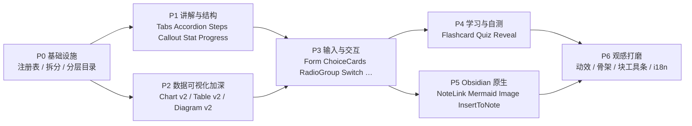

# 生成式界面（Intelligent UI）组件扩充计划

> 接续 [2026-10-22-intelligent-ui-plan.md](file:///d:/Vaults/Creative%20Vault/.dev/claudian-enhanced/docs/plans/2026-10-22-intelligent-ui-plan.md)。那份计划把**管线**（围栏 → 解析 → 求值 → 渲染 → 状态 → 回流）搭完了；这份计划只讲：**怎么把词汇表和表现力补到接近 ChatGPT Intelligent UI 的水平**，同时不突破 bundle 预算、不破坏安全不变量。

---

## 0. 实施状态（2026-10-25 完成）

| 阶段 | 状态 |
| --- | --- |
| P0 基础设施 | 完成。实际目录为 `ui/widgets/`（`context/layout/text/data/inputs/structure/learning/obsidian/index`），`components.ts` 降为查表分发；`BuildContext` 提供 `render/autoKey/host`；新增 catalog ⇄ registry 一致性测试 |
| P1 讲解与结构 | 完成。Tabs / Accordion / Steps / Timeline / Callout / Stat / Reveal，外加 Link / Icon / Markdown / Math / Progress 与 Card header |
| P2 数据加深 | 完成 Chart 负值/零基线/多系列/堆叠/横向/网格/图例/数值标签、Table 排序/列格式/对齐/highlight、Sparkline、Diagram v2（方向/描述/色调/edges/路径高亮） |
| P3 输入与交互 | 完成 ChoiceCards / RadioGroup / Switch / TextArea / NumberStepper / DatePicker / IconButton / Pressable / Form；Slider 拖动实时读数；TextArea 光标跨重建保持 |
| P4 学习自测 | 完成 Flashcard / Quiz（本地判分）/ Checklist |
| P5 Obsidian 原生 | 完成 NoteLink / NoteCard / Mermaid / Image / Tag、`@OpenNote`，以及默认关闭且必弹确认的 `@InsertToNote` |
| P6 观感打磨 | 完成入场动效、流式骨架、块工具条（复制程序/重置状态/放大）、大纲 `UI` 节点、新文案 10 个 locale；阅读模式折叠为一行摘要未做 |
| 目录与提示词 | 单档常驻（未做 `off/compact/full`）；`uiCatalog.ts` 为 54 条纯数据，提示词由它拼装，≤ 8,000 字符测试硬闸 |

**本轮偏差与遗留：**

- `blockKey` 刷新/回放已修：流式用消息 id、定稿后迁移到“消息内容指纹 + fence 序号”的稳定 scope；`adoptScope` 保留目标已有值。
- 块工具条的“复制”复制原始程序，而不是逐组件 `toMarkdown`；这是为避免给 54 个组件各写一份降级序列化。
- `Tag` 通过 Obsidian 搜索视图的 `setQuery` 打开；该 API 不是公开契约，已做 capability 守卫与静默降级。
- vault skill 自动生成、模型命中率评测未入库；阅读模式折叠与大綱筛选 chip 的 UI 未做。
- 顺手修复了两个语言层问题：`Button(@Set(...))` 的 `targets` 未被消费；`$day` 与 `day = ...` 同名时状态默认值被具名语句覆盖。

---


## 1. 现状诊断：为什么"不像 ChatGPT"

### 1.1 词汇量：24 vs 55

当前 [components.ts](file:///d:/Vaults/Creative%20Vault/.dev/claudian-enhanced/src/features/chat/rendering/ui/components.ts) 实现了 24 个组件；参考实现 OpenUI（`.context/open-intelligent-ui/src/generated/spec.json`）有 55 个。缺口按"用户能感知到的回答类型"归类：

| 回答类型 | ChatGPT 常见形态 | 我们缺什么 |
| --- | --- | --- |
| 分步讲解 / 教程 | 步骤条、可展开详情、分页标签 | `Tabs` `Accordion` `Steps` `Carousel` |
| 结论 / 指标 | 大号数字 + 涨跌、进度、提示框 | `Stat` `Progress` `Callout` |
| 富文本混排 | 卡片里嵌 Markdown、公式、链接、图标 | `Markdown` `Math` `Link` `Icon` |
| 选择 / 收集信息 | 选项卡片、单选组、开关、多行输入、表单一次性提交 | `ChoiceCards` `RadioGroup` `Switch` `TextArea` `DatePicker` `Form` `IconButton` `Pressable` |
| 学习 / 自测 | 翻转卡片、小测验、点击揭示 | `Flashcard` `Quiz` `Reveal` |
| 时间线 / 流程 | 时间轴、带连线的流程图 | `Timeline`；`Diagram` 只能纵向、无连线标签 |
| 自由绘图 | 示意图、几何讲解 | `Svg` 原语 |

### 1.2 已有组件"深度不够"

| 组件 | 问题 | 位置 |
| --- | --- | --- |
| `Chart` | 只读第一个 series；无坐标轴、网格线、图例、数值标签、悬停提示；无横向柱状图（窄侧栏最需要） | [readChartPoints](file:///d:/Vaults/Creative%20Vault/.dev/claudian-enhanced/src/features/chat/rendering/ui/components.ts#L578-L599) |
| `Chart`（line/area） | 对负值取 `Math.abs`，**负数会被画成正数**——这是正确性 bug | [buildLineChart](file:///d:/Vaults/Creative%20Vault/.dev/claudian-enhanced/src/features/chat/rendering/ui/components.ts#L649-L688) |
| `Table` | 不能排序、不能列对齐/数字格式化、无高亮行、长表不折叠 | [buildTable](file:///d:/Vaults/Creative%20Vault/.dev/claudian-enhanced/src/features/chat/rendering/ui/components.ts#L256-L285) |
| `Diagram` | 只有纵向层级；节点无描述、无边标签、无路径高亮 | [buildDiagram](file:///d:/Vaults/Creative%20Vault/.dev/claudian-enhanced/src/features/chat/rendering/ui/components.ts#L374-L413) |
| `Slider` | 拖动中读数不动（只在 `change` 时提交），手感明显比 ChatGPT 差 | [buildSlider](file:///d:/Vaults/Creative%20Vault/.dev/claudian-enhanced/src/features/chat/rendering/ui/components.ts#L476-L513) |
| `Card` | 没有 header 槽（标题/副标题/图标/右上角操作），每次都要模型手搭 Row | [buildLayout](file:///d:/Vaults/Creative%20Vault/.dev/claudian-enhanced/src/features/chat/rendering/ui/components.ts#L164-L169) |
| `Button` | 无图标、无 `Action([...])` 多步动作 | — |

### 1.3 基础设施的三个瓶颈（不先解决，加组件会越加越乱）

1. **目录手写、会漂移。** 模型看到的组件签名写死在 [generativeUi.ts](file:///d:/Vaults/Creative%20Vault/.dev/claudian-enhanced/src/core/prompt/generativeUi.ts#L34-L39) 的字符串里，渲染分发写在 [buildElement](file:///d:/Vaults/Creative%20Vault/.dev/claudian-enhanced/src/features/chat/rendering/ui/components.ts#L745-L785) 的 switch 里，两边没有任何一致性校验。组件从 24 涨到 50，必然出现"提示里有、渲染器没有"。
2. **单文件 785 行 switch。** 继续往里堆会变成千行级的单点。
3. **提示词常驻成本线性增长。** 每个组件约 25–40 token；再加 30 个就是每轮 +1k token，对没有 prompt cache 的 provider（Codex / DSH）是真金白银。

### 1.4 "感觉"层面的差距（不是组件，但同样决定观感）

- 无入场动效、无流式骨架（未解析引用直接空白）。
- 块级没有工具条：复制为 Markdown、放大查看、重置状态、插入到笔记。
- 读模式 / 大纲尚未把界面块当成节点（上一份计划 §11.4 遗留）。

---

## 2. 设计原则（沿用 + 新增）

沿用上一份计划的硬约束：**零 `innerHTML`、颜色白名单、仅 http(s) 外链、无 iframe / 远程图片、状态在 DOM 之外、改控件不触发模型回合**。

新增三条：

1. **一个组件 = 一条注册项。** 签名、描述、分组、示例、构建函数在一处声明；提示词目录、分发、文档、测试全部从它派生。
2. **先加深再加宽。** 修好 `Chart` / `Table` / `Slider` 的观感，比多 5 个冷门组件更能拉近与 ChatGPT 的差距。
3. **Obsidian 原生是差异化，不是附属。** ChatGPT 做不到"点一下打开 vault 里的笔记""把这张表插进当前笔记"——这是我们值得投入的地方。

---

## 3. 分阶段计划



### P0：基础设施（必须先做）

**目标：** 让"加一个组件"变成改 2 个文件 + 1 个测试的机械动作。

**Files:**
- New: `src/core/prompt/uiCatalog.ts` —— **纯数据**：`{ name, group, signature, description, tier }[]`。放 `core/` 是因为提示词在 `core/` 生成，而 `core/` 不能 import `features/`（架构守卫会拦）。
- New: `src/features/chat/rendering/ui/components/{layout,text,data,inputs,disclosure,media,obsidian,shared}.ts`，由 `components/index.ts` 汇总成 `Record<string, ComponentBuilder>`。
- Modify: [components.ts](file:///d:/Vaults/Creative%20Vault/.dev/claudian-enhanced/src/features/chat/rendering/ui/components.ts) 拆分后只保留 `renderValue` / `buildElement`（查表分发）。
- Modify: [generativeUi.ts](file:///d:/Vaults/Creative%20Vault/.dev/claudian-enhanced/src/core/prompt/generativeUi.ts) 由 `uiCatalog` 拼出组件段落。
- Modify: [UiBlockRenderer.ts](file:///d:/Vaults/Creative%20Vault/.dev/claudian-enhanced/src/features/chat/rendering/UiBlockRenderer.ts) 的 `UiBlockCallbacks` 扩展宿主能力（见下）。

**任务：**
- [ ] **测试先行** `tests/unit/core/prompt/uiCatalog.test.ts` + `tests/unit/features/chat/rendering/ui/registryParity.test.ts`：目录里每个名字都有 builder，反之亦然；签名里的 `$binding` 位置与 builder 读取的绑定参数位置一致。
- [ ] 纯重构式拆分 `components.ts`，现有 `components.test.ts` / `blockRenderer.test.ts` 零改动通过。
- [ ] **分层目录（tier）**：`core`（常驻，约 25 个高频组件，紧凑签名）+ `extended`（只放一行"还有这些组件可用"的名字列表 + 一份按需读取的说明）。设置项从布尔 `generativeUiEnabled` 升级为 `off | compact | full`，兼容旧值。
- [ ] 宿主回调扩展：`renderMarkdown(el, md)`（必须走 `MessageRenderer` 唯一的 Markdown 漏斗，保住 HTML 转义不变量）、`openNote(linktext)`、`resolveVaultResource(path)`、`insertIntoNote(markdown)`（P5 才启用）。
- [ ] 动作层：新增 `Action([@a, @b])` 顺序执行、`@Toggle($bool)`。

**验收：** 拆分后 bundle 增量 ≤ 3 KB；提示词在 `compact` 档下 token 数不高于现在。

---

### P1：讲解与结构（观感提升最大、成本最低）

| 组件 | 签名草案 | 说明 |
| --- | --- | --- |
| `Tabs` | `Tabs($active, tabs)`，`tabs = [{label, content}]` | 窄侧栏的"多视图"首选 |
| `Accordion` | `Accordion(items, $open?, multiple?)` | 原生 `<details>` 语义，可键盘操作 |
| `Steps` | `Steps(items, $current?, orientation?)` | 教程 / 流程的步骤条，可点击跳步 |
| `Timeline` | `Timeline(items)`，`{time, title, description?, color?}` | 历史 / 版本 / 计划 |
| `Callout` | `Callout(children, tone? "info"\|"success"\|"warning"\|"danger", title?)` | 视觉上对齐 Obsidian callout |
| `Stat` | `Stat(label, value, delta?, caption?)` | KPI 大字 + 涨跌色（正绿负红，可反转） |
| `Progress` | `Progress(value, max?, label?, variant? "bar"\|"ring")` | |
| `Link` | `Link(text, url)` | 走 `@OpenUrl` 同一白名单 |
| `Icon` | `Icon(name, size?, color?)` | 走 Obsidian `setIcon`（lucide），**名字白名单**，不接受 SVG 字符串 |
| `Markdown` | `Markdown(text)` | 走宿主 `renderMarkdown`，复用 LaTeX / wikilink / 转义 |
| `Math` | `Math(tex, block?)` | 实现上就是 `Markdown("$$…$$")` 的薄封装 |
| `Card`（加深） | `Card(children, variant?, title?, subtitle?, icon?, actions?)` | header 槽，减少模型手搭 Row |

示例（模型视角）：

````text
```claudian-ui
root = Col([head, tabs], 3)
$tab = "原理"
head = Row([Icon("brain"), Title("注意力机制", "lg")], 2, "center")
tabs = Tabs($tab, [{label: "原理", content: why}, {label: "公式", content: Math("\\text{softmax}(QK^T/\\sqrt{d})V", true)}, {label: "复杂度", content: cost}])
why = Steps(["把 token 投影成 Q/K/V", "Q 与 K 点积得到相关度", "softmax 归一化", "加权求和 V"])
cost = Row([Stat("时间", "O(n²·d)"), Stat("显存", "O(n²)")], 2)
```
````

**验收：** 一个"解释某概念"类问题，产出至少用到 Tabs/Steps/Callout 之一，且窄于 360 px 时无横向滚动。

---

### P2：数据可视化加深

- [ ] **`Chart` v2**（同一个组件，新增参数而非新组件）：
  - 多 series（`series: ["a", "b"]` 全部绘制）、`stacked`、`horizontal`（窄栏优先）、`scatter`。
  - 坐标轴 + 3–5 条网格线 + 刻度格式化（复用 `@Format`）；图例；可选数值标签。
  - 悬停/聚焦提示：SVG `<title>` 做无障碍兜底 + 一个绝对定位的 tooltip 元素（只写 `textContent`）。
  - **修 bug：** line/area 支持负值与零基线。
  - 新增 `Sparkline(values, color?)`：可嵌进 `Table` 单元格和 `Stat`。
- [ ] **`Table` v2**：`Table(columns, rows, options?)`，`columns` 允许 `{key, label, align, format}`；`$sort` 绑定点击排序；`highlight` 行；超过 N 行自动折叠 + "展开全部"；表头 sticky。
- [ ] **`Diagram` v2**：`direction "down"|"right"`、节点 `{id, label, description, tone}`、`edges: [{from, to, label}]`、选中节点高亮其上下游路径。仍然纯 HTML/CSS 布局，**不引入布局库**。
- [ ] 可选 `Gauge(value, min, max, label?)`。

**验收：** 带负值的折线、3 个 series 的柱状图、可排序表格各有快照测试；暗色/亮色两套截图人工过一遍。

---

### P3：输入与交互（让界面"能收集信息"）

| 组件 | 要点 |
| --- | --- |
| `ChoiceCards($value, options, multiple?)` | ChatGPT 最常见的"选一个方向"卡片；`options = [{id, title, description?, icon?}]` |
| `RadioGroup($value, options, label?)` | |
| `Switch($value, label?)` | 视觉区别于 Checkbox |
| `TextArea($value, label?, placeholder?, rows?)` | 复用现有焦点/光标保持逻辑 |
| `DatePicker($value, label?, mode? "date"\|"time"\|"datetime")` | 原生 `<input type=date>`，零依赖 |
| `NumberStepper($value, min, max, step?, label?)` | 比 Slider 精确 |
| `IconButton(icon, action, label)` | `label` 用作 `aria-label`，必填 |
| `Pressable(children, action)` | 整块可点（卡片即按钮） |
| `Form(children, submitLabel, prompt)` | 提交时把表单内所有 `$var` 打包为 `@ToAssistant(prompt, {…})`——**一次手势、一个回合** |

- [ ] **修 `Slider` 手感**：`input` 事件只原地更新读数节点（不写 store、不重建），`change` 时再提交。
- [ ] 必填/校验：`Form` 内控件支持 `required`，未填时提交按钮禁用。

**验收：** "帮我规划旅行"类问题能产出 `Form` → 用户填完点一次 → 恰好产生 1 个用户回合，且 `<untrusted_ui_state>` 里带全部字段。

---

### P4：学习与自测

- `Flashcard(front, back, $flipped?)`：CSS 3D 翻转（尊重 `prefers-reduced-motion`）。
- `Quiz(question, options, answer, explanation?, multiple?)`：选择 → 检查 → 显示对错与解析；**答案判定在本地**，不回模型。
- `Reveal(label, children)`：点击揭示（剧透 / 提示 / 答案）。
- `Checklist(items, $done)`：带完成进度的清单，可配合 `Progress`。

**验收：** 一组 5 题测验全程不触发模型回合；结束后"把错题发给助手"按钮带上错题列表。

---

### P5：Obsidian 原生（ChatGPT 没有的部分）

| 组件 / 动作 | 实现 | 安全边界 |
| --- | --- | --- |
| `NoteLink(linktext, label?)` | `workspace.openLinkText` | 只解析 vault 内链接；不存在的笔记显示为灰色，不自动创建 |
| `NoteCard(linktext)` | `metadataCache` 读标题、标签、首段摘要 | **只读**；单块最多 N 张，防止扫库 |
| `Mermaid(code)` | 走 `renderMarkdown` 的 ```` ```mermaid ```` 围栏，Obsidian 自带渲染 | 不额外打包 mermaid |
| `Image(path, alt?)` | `vault.adapter.getResourcePath` | 仅 vault 相对路径与 `data:`，**仍不加载远程图片** |
| `Tag(name)` | 点击打开 Obsidian 搜索 `tag:` | |
| `@InsertToNote(markdown)` | 插入到当前活动笔记光标处 | **必须弹确认**（显示预览 + 目标文件）；默认关闭，设置里显式开启 |
| `@OpenNote(linktext)` | 同 `NoteLink` | |

**验收：** 问"我的读书笔记里哪几本讲了习惯养成"，回答里的 NoteCard 可点开对应笔记；`@InsertToNote` 在未开启设置时不可用且有提示。

---

### P6：观感打磨

- [ ] 入场动效：块首次挂载淡入 + 轻微位移（120–180 ms），**流式重渲染不重复播放**（按 `blockKey` 记已播放）；`prefers-reduced-motion` 下关闭。
- [ ] 流式骨架：`root` 已到但子引用未解析时，显示占位条而不是空白。
- [ ] 块工具条（悬停出现）：复制为 Markdown（每个组件提供 `toMarkdown` 降级）、放大到 Modal、重置状态。
- [ ] 读模式折叠为一行摘要；大纲新增 `UI` 节点类型（[outlineExtraction.ts](file:///d:/Vaults/Creative%20Vault/.dev/claudian-enhanced/src/features/chat/ui/outlineExtraction.ts)）。
- [ ] i18n：10 个 locale 补齐新设置项与工具条文案。
- [ ] 容器查询（`@container`）而非视口媒体查询，适配侧栏宽度变化。

---

## 4. 明确不做

| 能力 | 理由 |
| --- | --- |
| `HtmlView` / iframe 沙箱 | 与"零 iframe、零 innerHTML"姿态冲突，且拿不到主题 |
| `Map`、`YouTube`、`SearchImage`、远程图片 | 网络请求 + referer 泄露上下文，插件无服务端可代理 |
| `Celebration`（彩带）、`Timer` | 观感收益低，`Timer` 还需要定时器生命周期管理 |
| 引入图表 / 布局 / UI 框架依赖 | bundle 余量不允许，见 §5 |

---

## 5. 预算

### 5.1 Bundle

| 项 | 值 |
| --- | --- |
| 预算上限（`scripts/check-startup-performance.mjs`） | 4,000,000 B（本轮从 3,850,000 提高） |
| 本地 `main.js`（本轮最终构建实测） | 3,854,727 B |
| **当前余量** | **≈ 142 KB** |
| `styles.css`（本轮最终构建实测） | 295,533 B |

| 阶段 | 估算增量 | 累计 |
| --- | --- | --- |
| P0 基础设施 | +3 KB | 3 KB |
| P1 讲解与结构 | +8 KB | 11 KB |
| P2 可视化加深 | +9 KB | 20 KB |
| P3 输入与交互 | +7 KB | 27 KB |
| P4 学习与自测 | +4 KB | 31 KB |
| P5 Obsidian 原生 | +5 KB | 36 KB |
| P6 打磨 | +3 KB | **39 KB** |

> [!WARNING]
> 累计估算吃掉约 80% 余量。每个阶段结束必须跑 `npm run check:performance` 记录实测值；若某阶段超估算 30% 以上，先压缩再进下一阶段，而不是最后才发现超线。

### 5.2 提示词 token

| 档位 | 常驻内容 | 估算 |
| --- | --- | --- |
| `compact`（建议默认） | 语法 + ~25 个核心组件签名 + 扩展组件**名字列表** | ≈ 1.2k token（与现在持平） |
| `full` | 全部 ~50 个组件签名 + 2 个示例 | ≈ 2.5k token |

扩展组件的详细签名放在 vault skill（`.claude/skills/obsidian-ui/`、`.codex/skills/obsidian-ui/`），由脚本从 `uiCatalog.ts` 生成，CI 里 diff 校验防漂移。

---

## 6. 质量保障

1. **每个组件的固定测试四件套**（`tests/unit/features/chat/rendering/ui/components/*.test.ts`）：正常渲染、缺参/错类型降级不抛错、绑定读写、`textContent` 断言（不含 HTML 解释）。
2. **注册表一致性测试**（P0）：目录 ⇄ builder ⇄ 签名绑定位置。
3. **黄金程序库** `tests/fixtures/ui/*.claudian-ui`：每个阶段新增 3–5 个"像真实模型输出"的程序，作为回归快照。
4. **模型命中率评测**（不入库，放 `.context/evals/ui/`）：一组 20 条提示（讲解 / 对比 / 规划 / 测验 / 数据），在 Codex、Claude 各跑一遍，统计 *出界面率、可解析率、未知组件率、平均 token*。每个阶段前后各跑一次——**组件变多但命中率下降，就说明目录写得不好**，这是比单测更关键的指标。
5. 每阶段收尾：`npm run typecheck && npm run lint && npm run test && npm run build` + 暗/亮主题真机截图。

---

## 7. 建议的执行顺序与工期

| 顺序 | 阶段 | 粗估 | 理由 |
| --- | --- | --- | --- |
| 1 | P0 | 1–1.5 天 | 不做的话后面每个组件都要改 3 处 |
| 2 | P2 中的 **Chart 负值 bug + Slider 手感** | 0.5 天 | 现有功能的正确性/手感问题，优先级高于新组件 |
| 3 | P1 | 2 天 | 观感提升最大 |
| 4 | P2 剩余 | 2 天 | |
| 5 | P3 | 2 天 | |
| 6 | P5 | 1.5 天 | 差异化 |
| 7 | P4 / P6 | 各 1 天 | |

---

## 8. 需要你拍板的问题

> **已拍板（2026-10-25）：** 四批组件全做；bundle 上限提到 4,000,000 B；提示词采用单档常驻（不做 `off/compact/full` 设置）；blockKey 回放问题已在本轮修复；`@InsertToNote` 以“默认关闭 + 每次确认”的形式提供。

1. **提示词策略**：默认 `compact`（常驻成本不变、扩展组件靠 skill 按需加载），还是直接 `full`（命中率更稳但每轮多 ~1.3k token）？
2. **写入 vault**：P5 的 `@InsertToNote` 是否要做？我的建议是做，但默认关闭 + 每次弹确认。
3. **预算**：如果实测余量不够，是接受把上限再提一档（例如 3,900,000 B），还是砍掉 P4 / P6 的部分组件？
4. **优先方向**：你日常最想让它出界面的是哪类问题——概念讲解 / 方案对比与规划 / 数据分析 / 学习自测 / 笔记库检索？这决定 P1–P5 的先后。
